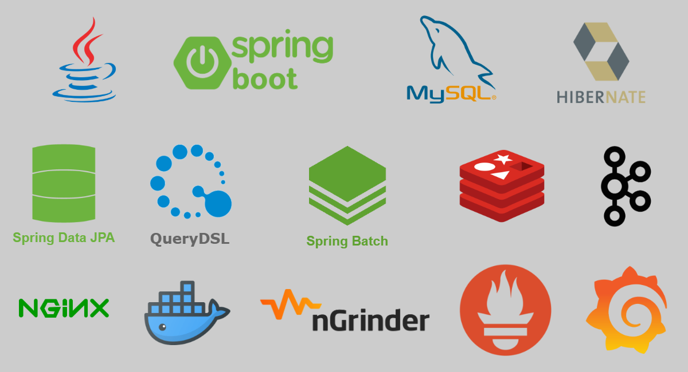
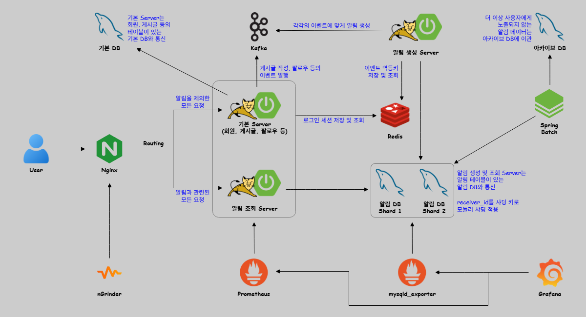
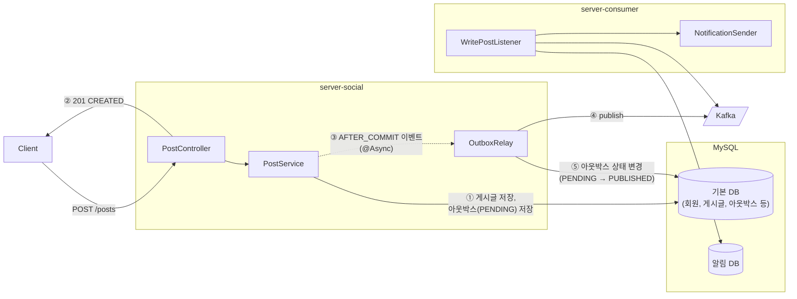
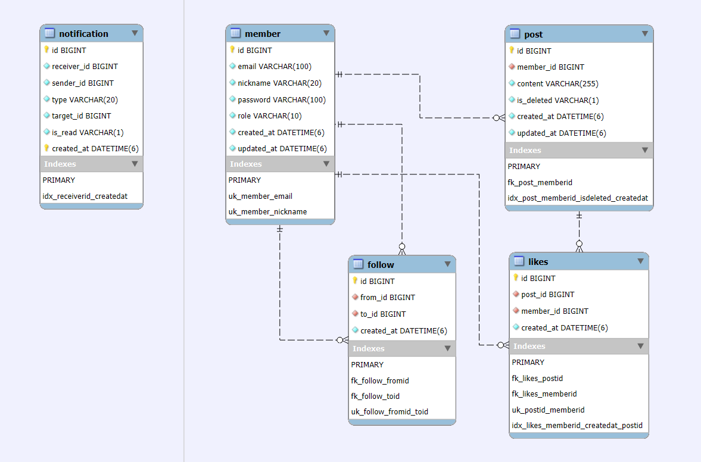

# CelFeed

```bash
docker compose up --build
```
```bash
docker compose -f docker-compose.yaml -f docker-compose-monitoring.yaml up --build
```

<br>

## 1. 소개

---
**CelFeed**(Celeb + Feed)는 셀럽 전용 SNS를 가정해 개발한 백엔드 API 프로젝트입니다.

셀럽이 `게시글을 작성`하면 팬들에게 알림이 전송되고, 팬이 `팔로우`하거나 `게시글에 좋아요`를 누르면 셀럽에게 알림이 전송됩니다.

이처럼 알림 이벤트를 중심으로 알림 기능 구현에 중점을 두었습니다.

<br>

**사용 기술** : `Java 21` / `Spring Boot 4.0.1` / `MySQL 8.4` / `Gradle 9.2.1`



<br><br>

## 2. 아키텍처

---
**멀티 모듈**

| 모듈명 | 설명 | 상세 설명 |
| --- | :--- | :--- |
| `server-social`| 기본 API 서버 (Producer) | 기본(회원, 게시글, 팔로우 등) SNS 기능 / 이벤트 발행 / `port:8080`|
| `server-notification` | 알림 조회 API 서버 | 알림 조회 전용 / 생성 서버와 분리해서 부하 및 장애 차단 / `port:8081`|
| `server-consumer`| 알림 생성 서버 (Consumer) | `server-social`에서 발행한 이벤트(게시글 작성, 팔로우 등)를 받아 알림 생성 |
| `server-batch`| 배치 서버 | 사용자에게 노출되지 않는 알림 데이터 아카이브 DB에 이관 |
| `common-web` | 웹 계층 공통 처리 | 인터셉터 기반 로그인 체크, 전역 예외 처리, 공통 응답 포맷|
| `common-event` | 이벤트 메시지 공통 정의 | 서버끼리 `Kafka`로 주고받는 이벤트 메시지와 토픽 정의|
| `domain-social` | 기본 도메인 | 기본(회원, 게시글, 좋아요 등) DB의 엔티티와 리포지토리 정의 |
| `domain-notification` | 알림 도메인 | 알림 DB의 엔티티와 리포지토리 정의|
| `infra-sharding`| DB 샤딩 설정 | 샤딩 처리된 알림 DB를 위한 샤딩 관련 코드 |

<br>

**전체 구조**



- 사용자의 요청은 Nginx에서 경로에 따라 **기본 서버** 또는 **알림 조회 서버**로 라우팅됩니다.
- **알림 생성 서버**는 외부에 노출되지 않고, 기본 서버(Producer)에서 발행한 이벤트가 Kafka로 전달되면 알림 생성 서버(Consumer)가 이벤트를 처리합니다.
- **기본 DB**에는 회원, 게시글 등의 테이블이 존재하며, **알림 DB**에는 샤딩을 적용했습니다.

<br>

**알림 발생 흐름**


<br>

## 3. ERD

---


- [ERD 설계 및 근거](docs/erd/erd.md)

<br>

## 4. 알림 서버의 발전
1. [JdbcTemplate : 벌크 INSERT 최적화](docs/issues/issue1.md)
2. [알림 생성 서버와 조회 서버의 분리 : 장애 전파 차단](docs/issues/issue2.md)
3. [Thread Pool 기반 알림 생성 비동기 처리 : 응답 시간 단축](docs/issues/issue3.md)
4. [Message Queue 도입 : 알림 데이터 보호](docs/issues/issue4-0.md)
   - [[Querydsl] Cursor-based Pagination](docs/issues/issue4-1.md)
5. [알림 테이블 파티셔닝 : 데이터 조회 및 삭제 쿼리 속도 향상](docs/issues/issue5-0.md)
   - [[JPA] 복합 키와 @GeneratedValue를 함께 사용할 수 없는 제약](docs/issues/issue5-1.md)
   - [[Spring Batch] 대량의 알림 데이터 이관](docs/issues/issue5-2.md)
6. [알림 DB 샤딩 : 트래픽 분산](docs/issues/issue6-0.md)
   - [[JPA] Snowflake ID 키 생성기 적용](docs/issues/issue6-1.md)
   - [[JPA] 샤딩 적용 과정에서 발생한 알림 엔티티의 연관관계 문제](docs/issues/issue6-2.md)

<br>

## 5. 공통 처리
- [Spring Interceptor를 활용한 공통 로그인 체크](docs/commons/common1.md)
- [HandlerMethodArgumentResolver를 활용하여 로그인 ID 쉽게 가져오기](docs/commons/common2.md)
- [@ExceptionHandler를 활용한 공통 예외 처리 (ft. HandlerExceptionResolver)](docs/commons/common3.md)
- [공통 응답 포맷](docs/commons/common4.md)
